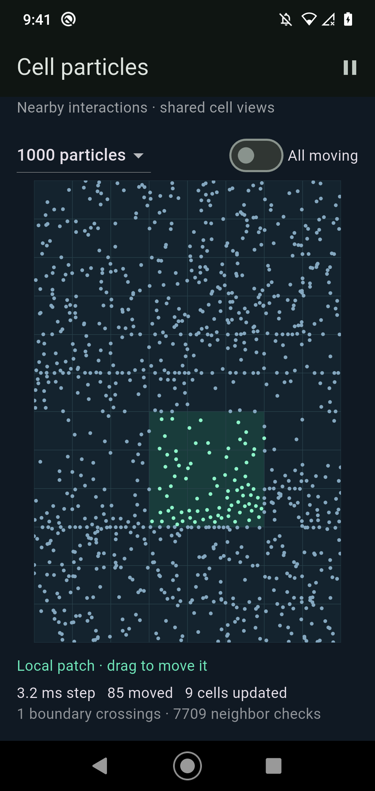

# Spatial particle demo on Android

The demo uses 96 long-lived Datafriend queries, one per cell of an 8×12 grid.
Each particle stores `x`, `y`, and `region`. Queries constrain region and project
coordinates. No query is recreated when a particle crosses a cell boundary.

A tick reads the cached results of each active cell and its eight neighbors,
computes short-range repulsion plus deterministic drift, and submits all changed
coordinates and memberships in one blocking edit. Notifications identify changed
entities; only their coordinates are read back. Membership changes additionally
refresh the affected cell's entity IDs. Disk flushing remains asynchronous. There
is no network connection in this benchmark.

The interactive app is installed separately as **Cell particles**. It supports
100, 300, 1,000 and 3,000 particles, pause/resume, and a switch between local
activity and all particles moving. Dragging the board positions the active patch.

## Workload and measurement

- Moto G7 (`ZY227364TP`), Android 10, 60 Hz display; Flutter profile/AOT.
- Production native router. Native C/C++ compiled with `-O3 -DNDEBUG`.
- Local mode moves a 3×3-cell patch automatically every 90 ticks. Particles
  outside it remain stationary, but participate as repulsion neighbors. This is
  a controlled locality test, not a fully active physical system.
- All-moving mode still uses neighboring cells, not global all-to-all interaction.
- Fixed 640×960 world, cell width 80, interaction radius 24. Increasing particle
  count increases density, so neighbor-pair work grows faster than linearly.
- Each run seeds a fresh database deterministically. Two randomized-order rounds
  per case; 60 warm-up ticks and 240 measured ticks per run.
- One fixed 1/60-second simulation step per ticker callback, with no catch-up.
  When frames are missed, the simulation slows down; this is visible in measured
  frame intervals. FPS below is callback cadence, not a count of physically
  presented display frames.
- No CPU pinning. Battery temperature, thermal service, CPU frequencies and load
  are saved around every case. This measures the real app with normal scheduling.
- Engine frame numbers match simulation samples to Flutter build/raster timings.
  Timed work excludes startup and correctness validation.

## Phone results (2026-10-08)

Pooled samples from both rounds, 480 measured ticks per row. “Step” includes
physics, preparation of triples, the blocking edit, callbacks and cache refresh;
it excludes painting/rasterization. A smooth 60 Hz interface needs headroom beyond
the step itself. FPS uses the mean measured ticker interval.

| Particles | Activity | Moving/tick, median | Step median / p95 | FPS | Intervals >25 ms |
|---:|---|---:|---:|---:|---:|
| 100 | local | 6 | 1.40 / 2.30 ms | 60.0 | 0.0% |
| 100 | all | 100 | 5.23 / 5.73 ms | 60.0 | 0.0% |
| 300 | local | 20 | 2.17 / 3.28 ms | 60.0 | 0.0% |
| 300 | all | 300 | 12.11 / 12.56 ms | 57.5 | 4.4% |
| 1,000 | local | 80 | 4.05 / 4.48 ms | 60.0 | 0.0% |
| 1,000 | all | 1000 | 34.96 / 37.81 ms | 20.5 | 100.0% |
| 3,000 | local | 247 | 11.13 / 12.53 ms | 58.4 | 2.7% |
| 3,000 | all | 3000 | 89.04 / 101.87 ms | 9.7 | 100.0% |

The comfortable case here is **1,000 total particles with local activity**:
about 80 move per tick, typically nine views change, and all measured intervals
in the short sweep stay below 25 ms. Three thousand total particles with roughly
250 moving approaches 60 fps in these short runs, but the sustained result below
shows it is not reliably smooth. Updating every particle hits the frame budget much sooner: 300 is borderline, 1,000 is too slow for a 60 Hz simulation.
This is a limit for this workload on this phone, not a universal entity limit.

A longer **1,800-tick / ~35-second** local run at 3,000 particles averaged
**51.1 fps**, with **12.42 ms median / 14.82 ms p95** steps and 16.6% of intervals
above 25 ms. It passed validation after 3,450 measured cell crossings. Median
moving count rose to 265 as the patch traversed the scene; six consecutive
300-tick windows ranged from 44.6 to 58.8 fps. Temperature stayed at 27.1–27.2 °C.
Treat 3,000 as a stress case, not a reliable 60 fps capacity. [Sustained results](benchmarks/datafriend-android-particles-sustained.csv)
and [raw samples](benchmarks/datafriend-android-particles-sustained-runs/3000-local-1.json).

The same **1,800-tick / 30-second** sustained check at **1,000 particles** held
**60.0 fps**, with **4.10 ms median / 4.61 ms p95** steps and about 79 particles
moving per tick. State and frame timing checks passed.
[1,000-particle sustained results](benchmarks/datafriend-android-particles-sustained-1000.csv).

Median component times in milliseconds:

| Case | Physics | Prepare triples | Blocking edit | Cache refresh | Flutter build | Raster |
|---|---:|---:|---:|---:|---:|---:|
| 1,000 local | 0.48 | 0.21 | 3.09 | 0.25 | 5.33 | 6.97 |
| 1,000 all | 4.87 | 1.94 | 25.48 | 2.54 | 36.51 | 8.69 |
| 3,000 local | 2.34 | 0.61 | 7.46 | 0.68 | 12.52 | 7.56 |
| 3,000 all | 21.46 | 4.26 | 57.71 | 5.34 | 90.37 | 6.62 |

Blocking edit includes Dart encoding, native database/index/query/publication
work, and notification dispatch; this experiment does not separate those parts.
It dominates the all-moving case, with neighbor-pair physics a secondary cost at
3,000 particles. Flutter build already includes synchronous tick work; do not add
it to the step. Build and raster execute as a pipeline, and their medians should
not be added to infer FPS.

All 16 cases passed validation: 3,840 measured ticks and 20,704 cell crossings.
Battery temperature stayed between 26.4 and 26.9 °C. No thermal warning aborted
the sweep, though this does not establish absence of all clock variation.

[Per-run summaries](benchmarks/datafriend-android-particles.csv),
[pooled metrics](benchmarks/datafriend-android-particles-aggregate.json),
[raw frames](benchmarks/datafriend-android-particles-runs),
[device conditions and hashes](benchmarks/datafriend-android-particles-metadata.json),
[actual native compile commands](benchmarks/datafriend-android-particles-native-flags.json).

## Rendering finding

An initial implementation gave each cell its own repaint boundary. Even with
only 100 particles and local activity, the optimized build achieved about 32 fps.
With the same native engine, a single canvas using cached `Float32List` point
buffers reached 60 fps. The single canvas redraws all cached particles; spatial
selectivity applies to simulation, subscriptions and readback, not clipping the
render pass to dirty cells. The optional `cells` renderer is retained for this
comparison.

The first smoke build also exposed missing native optimization in the Android
profile configuration. The Gradle build now explicitly optimizes native code in
profile/release; debug is unchanged. The pre-fix smoke run is diagnostic only.

## Correctness

Three native-backed Flutter tests cover wrapped cell crossings, neighbor-cell
physics against an all-pairs reference (including coincident particles and world
wrap), and unchanged distant cells during local activity. Each phone run verifies
all memberships and coordinates against authoritative database facts, checks that
no particles were lost or duplicated, and requires complete engine timing coverage
with no Flutter errors.

## Reproduction

From `src/app`:

```sh
DATAFRIEND_PARTICLE_DEMO=1 flutter build apk --profile \
  --target lib/particle_main.dart --target-platform android-arm64
```

From the repository root:

```sh
python3 src/app/tool/run_particle_demo.py
```

The runner installs the separate package and saves raw frame samples, summaries,
source/APK hashes and device conditions under `docs/benchmarks`. Use
`--renderer cells --counts 100 --modes local --rounds 1` for the layer comparison;
choose a different `--output-prefix` to preserve the main results.

Sources: [Flutter entry point](../src/app/lib/particle_main.dart),
[simulation and cell queries](../src/app/lib/particles/simulation.dart),
[runner](../src/app/tool/run_particle_demo.py),
[tests](../src/app/test/particle_simulation_test.dart).

## Phone screenshot


